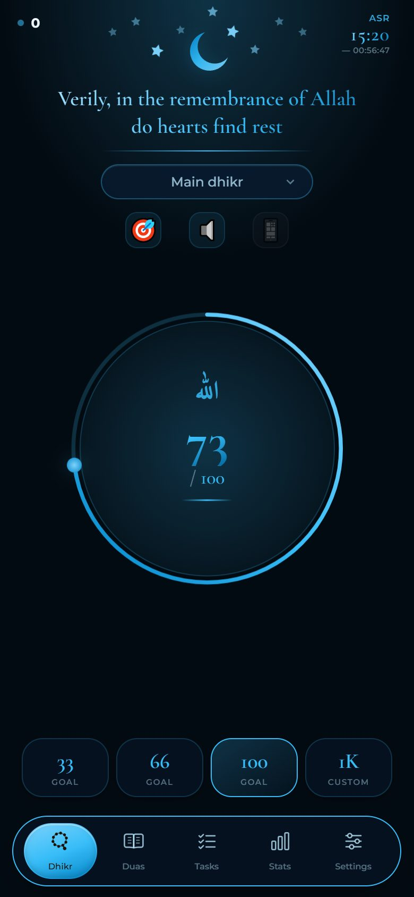
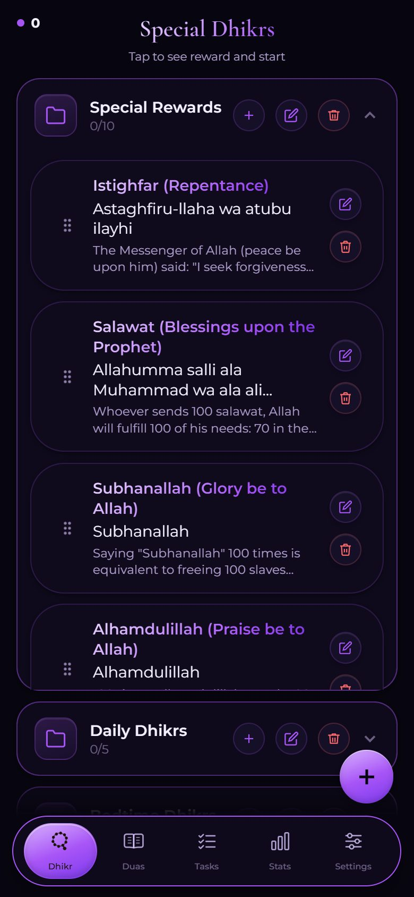
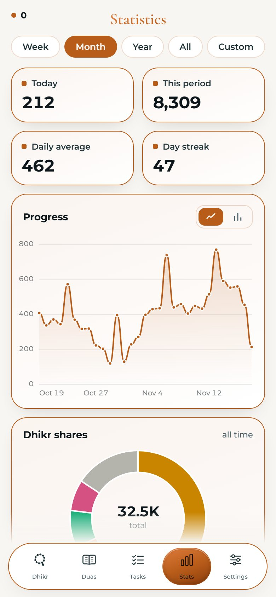
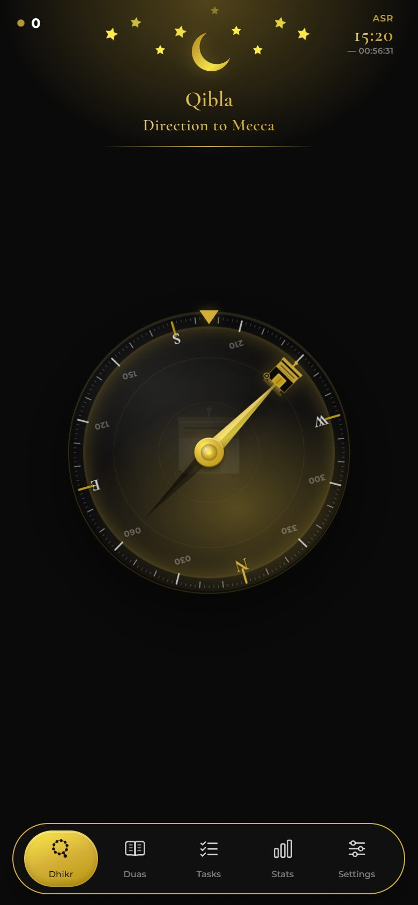

<div align="center">


# Azkar

**Tasbih counter, duas, prayer times and qibla — in your pocket.**

Free, ad‑free, works offline, in 15 languages.

[**Open the web app**](https://sunnyberd.github.io/Tasbih/) ·
[**Download for Android**](https://github.com/sunnyberd/Tasbih/releases/latest/download/Azkar.apk) ·
[Website](https://sunnyberd.github.io/Tasbih/site.html) ·
[Русский](README.ru.md)

[](https://github.com/sunnyberd/Tasbih/releases/latest)


</div>

<p align="center">
  
  
  
  
</p>

## Features

| | |
|---|---|
| **Tasbih counter** | Goals of 33 / 66 / 100 or your own, auto‑extend, add a number by long‑press, sound and vibration |
| **Special dhikrs** | Dhikrs with their rewards from authentic hadiths, folders, daily progress that resets at Fajr |
| **After‑salah dhikr** | SubhanAllah ×33 → Alhamdulillah ×33 → Allahu Akbar ×33 → La ilaha illallah ×1 |
| **Duas & 99 Names** | Your own duas with folders and favourites, the 99 Names of Allah with meanings |
| **Daily tasks** | Checklists with folders and sub‑folders, daily tasks reset at Fajr, task statistics |
| **Prayer times & qibla** | 20 calculation methods (picked automatically by country), high‑latitude rule, qibla compass |
| **Statistics** | Day / week / month / year, streaks, share of each dhikr, custom periods |
| **Dark dhikr mode** | Fully black screen, tap anywhere to count; on Android also hides system bars and silences other apps |
| **Floating counter** | Android: a bubble over other apps — every tap is counted, even when the app is asleep |
| **Reminders** | Prayer times, Abu Umamah's dua; on Android they arrive even when the app is closed |
| **Sync & backup** | Google sign‑in with cloud sync between devices, export / import to a file |
| **Themes** | Dark and light themes in many colours |

Languages: English, Русский, Oʻzbek, Deutsch, Español, Français, Italiano, 日本語, 한국어, 中文, Türkçe, हिन्दी, Bahasa Melayu, Bahasa Indonesia, ไทย.

## Install

- **Android** — download [`Azkar.apk`](https://github.com/sunnyberd/Tasbih/releases/latest/download/Azkar.apk) from the latest release and open it. The app tells you when a new version is out.
- **Any phone or computer** — open [sunnyberd.github.io/Tasbih](https://sunnyberd.github.io/Tasbih/) and choose *Add to Home screen* / *Install app*.

## Project structure

```text
.
├── index.html            # the app (PWA)
├── site.html             # landing page with reviews
├── sw.js                 # service worker: offline cache, reminders, push
├── manifest.json         # PWA manifest
├── version.json          # latest Android version (checked by the app)
├── css/                  # styles
├── js/
│   ├── app.js            # app logic
│   ├── native.js         # bridge to the Android app (Capacitor)
│   ├── feedback.js       # in‑app reviews
│   ├── site.js           # landing page
│   └── ...
├── i18n/                 # UI translations, one file per language
├── data/                 # special dhikrs, hadiths, 99 Names, default tasks
├── fonts/                # self‑hosted fonts
├── sounds/               # notification sounds
└── assets/
    ├── icons/
    └── screenshots/
```

## Tech

- Plain HTML, CSS and JavaScript — no framework; served by GitHub Pages. This repository holds the published (minified) build.
- Service Worker for offline use and reminders; Web Push through a small Cloudflare Worker.
- Android app built with [Capacitor](https://capacitorjs.com/) plus native Java for the floating counter, exact alarms, vibration and Do Not Disturb.
- Firebase Authentication (Google) and Cloud Firestore for sync and reviews.

## Changelog

See [CHANGELOG.md](CHANGELOG.md).

## Feedback

Leave a review or an idea on the [website](https://sunnyberd.github.io/Tasbih/site.html#reviews) or open an [issue](https://github.com/sunnyberd/Tasbih/issues).

## License

© 2026 sunnyberd. **All rights reserved.** The source code is public so it can be read, but it may not be copied, modified or republished without permission. See [LICENSE](LICENSE).
