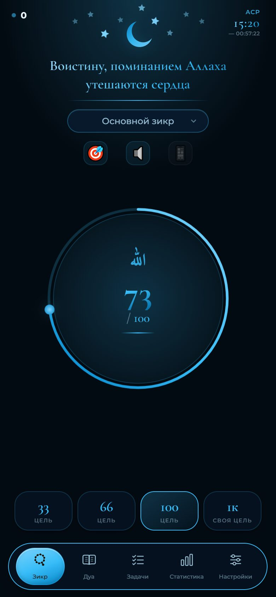
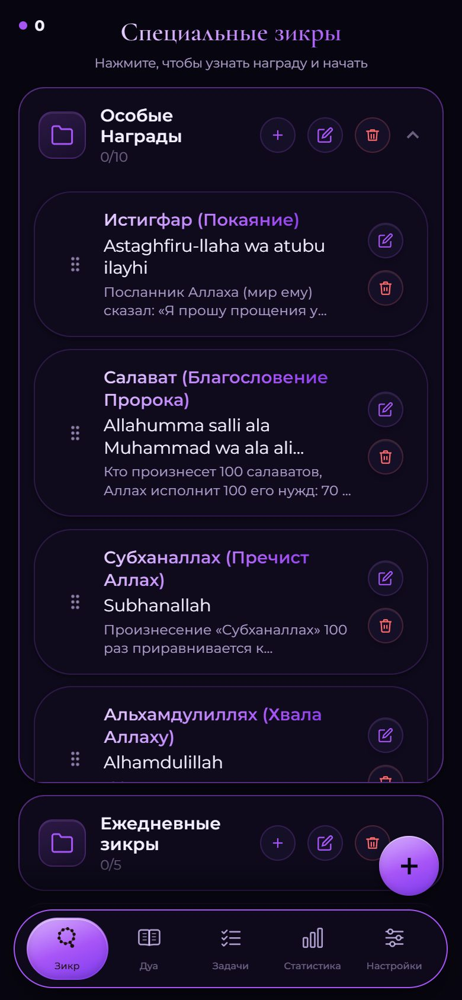
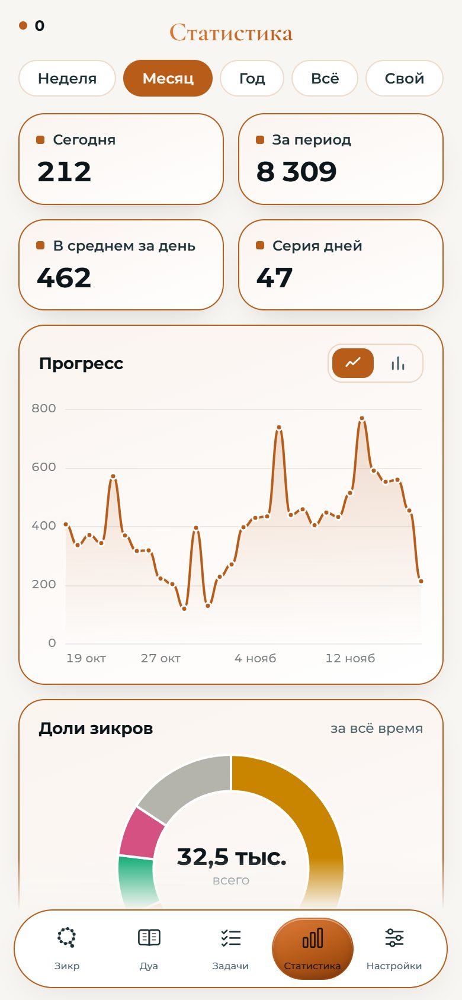
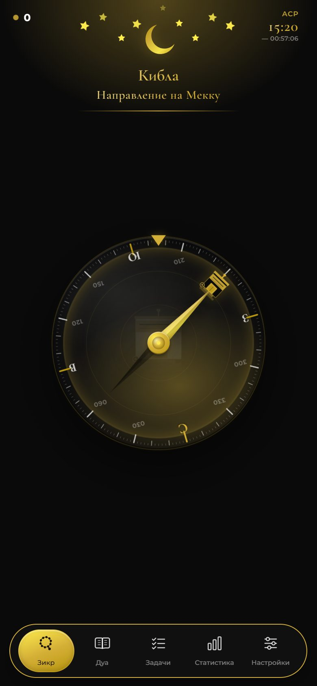

# Azkar

**Тасбих, дуа, время намаза и кибла — в вашем телефоне.**

Бесплатно, без рекламы, работает без интернета, на 15 языках.

[**Открыть веб-версию**](https://sunnyberd.github.io/Tasbih/) ·
[**Скачать для Android**](https://github.com/sunnyberd/Tasbih/releases/latest/download/Azkar.apk) ·
[Сайт](https://sunnyberd.github.io/Tasbih/site.html) ·
[English](README.md)

  
  
  
  

## Возможности

| | |
|---|---|
| **Счётчик тасбиха** | Цели 33 / 66 / 100 или своя, авто-продление, добавление числа удержанием, звук и вибрация |
| **Особые зикры** | Зикры с наградами из достоверных хадисов, папки, дневной прогресс со сбросом на Фаджр |
| **Зикры после намаза** | Субханаллах ×33 → Альхамдулиллях ×33 → Аллаху Акбар ×33 → Ля иляха илляЛлах ×1 |
| **Дуа и 99 имён** | Свои дуа с папками и избранным, 99 имён Аллаха со значениями |
| **Задачи на день** | Списки с папками и подпапками, ежедневные задачи сбрасываются на Фаджр, статистика задач |
| **Намазы и кибла** | 20 методов расчёта (выбор по стране автоматически), правило для северных широт, компас киблы |
| **Статистика** | День / неделя / месяц / год, серии дней, доли зикров, свой период |
| **Тёмный режим зикра** | Полностью чёрный экран, тап в любом месте — +1; в Android ещё прячет панели и глушит другие приложения |
| **Плавающий счётчик** | Android: кнопка поверх других приложений — засчитывается каждое нажатие, даже когда приложение спит |
| **Напоминания** | Время намаза, дуа Абу Умамы; в Android приходят даже при закрытом приложении |
| **Синхронизация и бэкап** | Вход через Google и синхронизация между устройствами, экспорт / импорт в файл |
| **Темы** | Тёмные и светлые темы разных цветов |

## Установка

- **Android** — скачайте [`Azkar.apk`](https://github.com/sunnyberd/Tasbih/releases/latest/download/Azkar.apk) из последнего выпуска и откройте. О новой версии приложение скажет само.
- **Любой телефон или компьютер** — откройте [sunnyberd.github.io/Tasbih](https://sunnyberd.github.io/Tasbih/) и выберите «Добавить на главный экран» / «Установить приложение».

## Устройство проекта

Обычные HTML, CSS и JavaScript без фреймворков, сайт работает на GitHub Pages, а в репозитории лежит опубликованная (сжатая) сборка. Service Worker отвечает за работу без интернета и напоминания. Android-приложение сделано на Capacitor, а плавающий счётчик, будильники, вибрация и «Не беспокоить» написаны на Java. Вход и синхронизация — Firebase. Подробная структура папок — в [README.md](README.md#project-structure).

## История изменений

[CHANGELOG.md](CHANGELOG.md)

## Отзывы

Оставьте отзыв или идею на [сайте](https://sunnyberd.github.io/Tasbih/site.html#reviews) или создайте [issue](https://github.com/sunnyberd/Tasbih/issues).

## Лицензия

© 2026 sunnyberd. **Все права защищены.** Код открыт для просмотра, но копировать, изменять и публиковать его без разрешения автора нельзя. Подробнее — в [LICENSE](LICENSE).
